<p align="center">
  
</p>

<h1 align="center">Coffee Delivery</h1>

<p align="center">
  SPA de cafeteria: catálogo, carrinho, checkout com consulta de CEP e confirmação do pedido.<br />
  Projeto final da disciplina <strong>Single Page Application (SPA)</strong>, feito com React + TypeScript + IA.
</p>

<p align="center">
  <a href="#-aplicação-publicada">Aplicação publicada</a> ·
  <a href="#-como-executar">Como executar</a> ·
  <a href="#-evidências">Evidências</a> ·
  <a href="#-branding-com-ia">Branding com IA</a> ·
  <a href="#-uso-de-ia-no-desenvolvimento">Uso de IA</a>
</p>

---

## 🌐 Aplicação publicada

> **Link:** _a preencher após o deploy (T-27)._
> O projeto já está configurado para Vercel (`vercel.json`) e Netlify (`public/_redirects`), com
> fallback de rotas para que o F5 em `/checkout` e `/success` não dê 404.

**Figma de referência:** [Coffee Delivery • Projeto Final React](https://www.figma.com/design/yGPNTA0Yczb183EikXGIiA/Coffee-Delivery-%E2%80%A2-Projeto-Final-React?node-id=2-1297)

## 🎯 Objetivos

- Fluxo completo de e-commerce: **Home → Checkout → Confirmação**, sem backend e com pedido fictício.
- Consolidar **React, TypeScript, Props, Hooks, Context API + useReducer, React Router, React Hook Form + Zod e localStorage**.
- Interface **responsiva** (320 px a 1440 px), **acessível** (WCAG 2.2 AA) e com **modo claro/escuro**.
- **Identidade visual própria**, com logo criada com IA.
- Planejamento por especificações e uso **documentado e crítico** de um assistente de IA.

## ✨ Funcionalidades

| | Funcionalidade | Requisitos |
|---|---|---|
| ☕ | Catálogo com imagem, nome, descrição, preço e tags | RF-01 |
| ➕ | Quantidade (1–99) antes de adicionar; o mesmo café soma na mesma linha | RF-02, RF-03, RN-01, RN-02 |
| 🛒 | Contador no Header com a **soma das unidades** | RF-04 |
| ✏️ | Aumentar, diminuir (bloqueado em 1) e remover itens no checkout | RF-05 |
| 💾 | Carrinho salvo no `localStorage` (sobrevive ao F5 e sincroniza abas) | RF-06 |
| 📍 | Endereço com **ViaCEP**: preenche rua, bairro, cidade e UF; trata carregando, CEP inválido, não encontrado e API fora do ar | RF-08, RN-07 |
| 💳 | Pagamento: crédito, débito ou dinheiro (apenas informativo) | RF-09, RN-05 |
| 🧮 | Subtotal, entrega fixa de **R$ 3,50** e total, calculados em centavos | RF-10, RN-03, RN-04 |
| ✅ | Confirmação com snapshot do pedido; o carrinho é limpo e a tela continua correta | RF-11..RF-13, RN-06 |
| 🌗 | Modo claro/escuro persistido, com fallback para a preferência do sistema | RF-14 |
| 📱 | Layout mobile first em todas as telas | RF-15 |

## 🧰 Stack

| Tecnologia | Uso |
|---|---|
| React 19 + Vite 8 + TypeScript 6 (`strict`) | SPA e tipagem |
| React Router 7 | Rotas `/`, `/checkout`, `/success` |
| Context API + `useReducer` | Estado global do carrinho e do tema |
| React Hook Form + Zod 4 | Formulário e validação (um schema gera os tipos) |
| styled-components 6 | Estilos com tokens de tema claro/escuro |
| Phosphor Icons | Ícones |
| ViaCEP | API pública de CEP |
| Vitest + Testing Library | Testes unitários e de integração |
| Playwright + axe-core | E2E e auditoria de acessibilidade |
| ESLint + Prettier | Qualidade e formatação |

Justificativas em [`docs/TECH_SPEC.md`](docs/TECH_SPEC.md) §1 e §15.

## 🚀 Como executar

Pré-requisitos: **Node.js ≥ 20.19** e npm.

```bash
git clone <url-do-repositório>
cd coffee-delivery
npm install
npm run dev          # http://localhost:5173
```

| Script | O que faz |
|---|---|
| `npm run dev` | Servidor de desenvolvimento |
| `npm run build` / `npm run preview` | Build de produção e pré-visualização |
| `npm run lint` · `npm run typecheck` | ESLint · TypeScript |
| `npm run format` | Prettier |
| `npm test` · `npm run test:run` | Vitest em modo watch · execução única |
| `npm run test:e2e` | Playwright (sobe build + preview; usa o Google Chrome instalado¹) |
| `npm run generate:images` | Regera as ilustrações SVG dos cafés |

¹ Sem Google Chrome: rode `npx playwright install chromium` e remova `channel: 'chrome'` do `playwright.config.ts`.

## 🏗️ Arquitetura

```
main.tsx: ThemeProvider → CartProvider → BrowserRouter → App (rotas)
pages/        Home · Checkout · Success        (compõem componentes)
components/   UI reutilizável, props tipadas    (CoffeeCard, CartItem, …)
hooks/        useCart · useTheme · useCep · useLocalStorage
contexts/     CartContext · ThemeContext
reducers/     cartReducer (puro e imutável)
utils/        pricing · format · storage · cep · order   (funções puras)
schemas/      checkoutSchema · orderSchema (Zod)
data/ types/ styles/
```

**Fluxo do estado global:** `CoffeeCard` chama `addItem` (de `useCart`) → `dispatch({ type: 'ADD_ITEM' })`
→ `cartReducer` devolve um **novo** estado → `useEffect` grava no localStorage → `CartBadge` e
`CartSummary` re-renderizam com `totals` recalculado por `useMemo`.

### Decisões principais

- **Dinheiro em centavos** (inteiros); formatação BRL só na exibição.
- **Taxa de entrega** definida em um só lugar: `DELIVERY_FEE_CENTS` em `src/utils/pricing.ts`.
- **No carrinho, "−" fica bloqueado em 1**; para tirar o item, usa-se "Remover" (D-02).
- **Pedido = snapshot** em `coffee-delivery:last-order:v1`, validado com Zod ao ler.
- **Leitura defensiva** do localStorage: JSON corrompido ou itens inexistentes são descartados.
- **Contraste AA verificado em teste**. Por isso algumas cores foram ajustadas em relação ao Figma (PRD D-10).

Detalhes: [`docs/PRD_SPEC.md`](docs/PRD_SPEC.md) · [`docs/TECH_SPEC.md`](docs/TECH_SPEC.md) ·
[`docs/TASKS_SPEC.md`](docs/TASKS_SPEC.md) · [`AGENTS.md`](AGENTS.md)

## 🧪 Testes

| Suite | Resultado |
|---|---|
| `npm run test:run`: reducer, cálculo, formatação, schema, storage, CEP (fetch simulado), tema, contraste, componentes e fluxo | **131 testes passando** |
| `npm run test:e2e`: fluxo completo em 1280 e 390 px, compra só pelo teclado, sem rolagem em 320 px, logo/favicon, tema e **12 auditorias axe (WCAG A/AA)** | **23 passando** |

Os casos TC-01 a TC-34 e a matriz RF/RN → teste estão na [`TECH_SPEC`](docs/TECH_SPEC.md) §11 e §14.

## 📸 Evidências

Capturas geradas com `node scripts/screenshots.mjs` (Playwright + Chrome).

### Desktop (1280 px)

| | Claro | Escuro |
|---|---|---|
| Home | 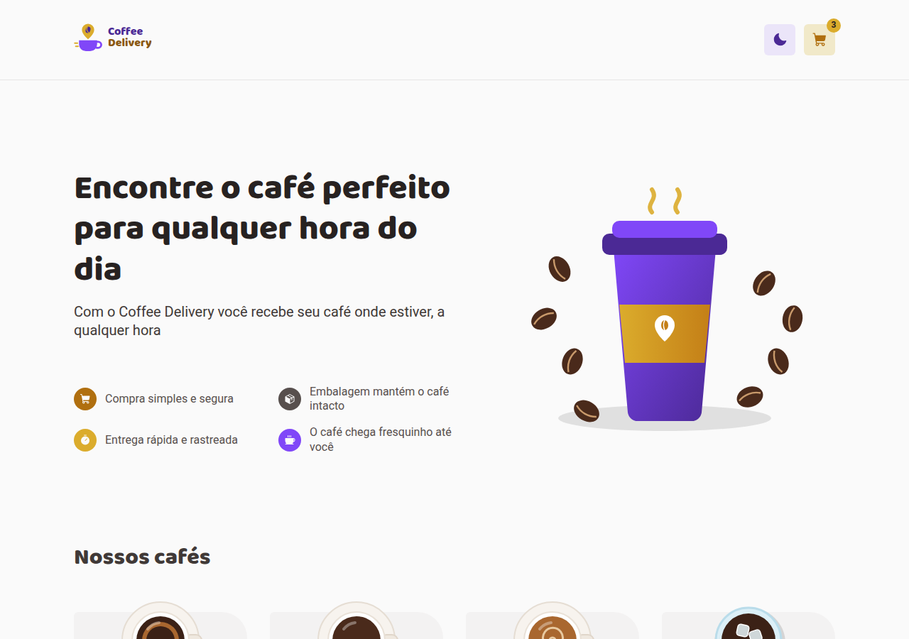 | 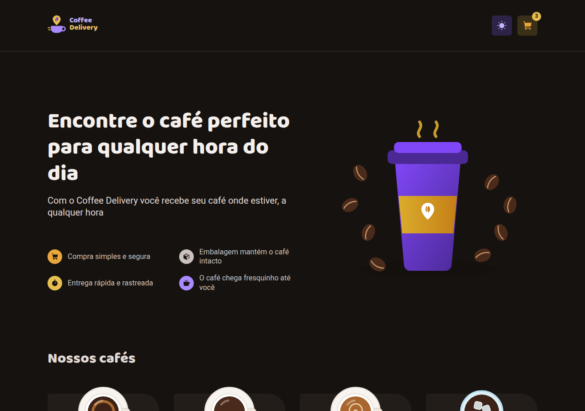 |
| Checkout | 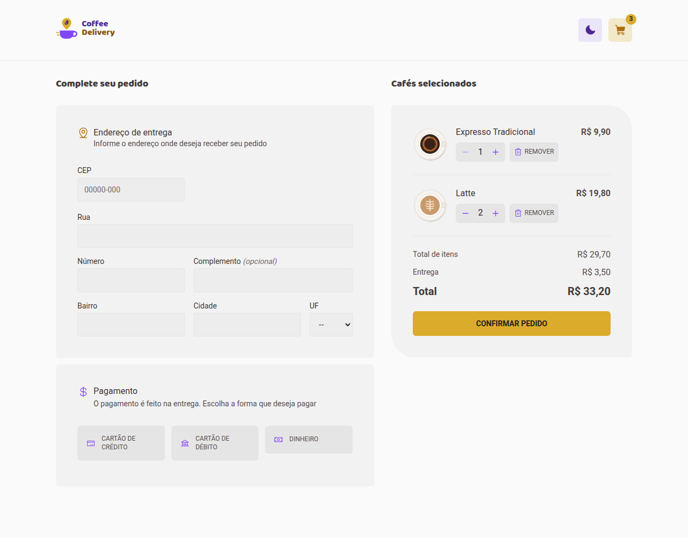 | 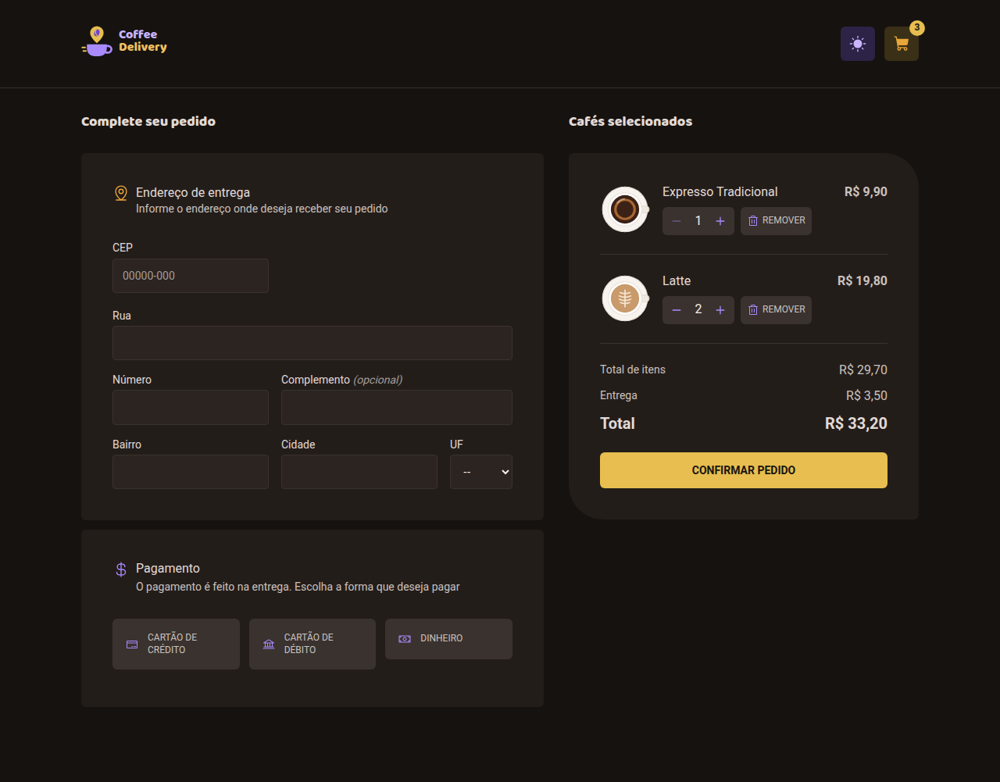 |
| Sucesso | 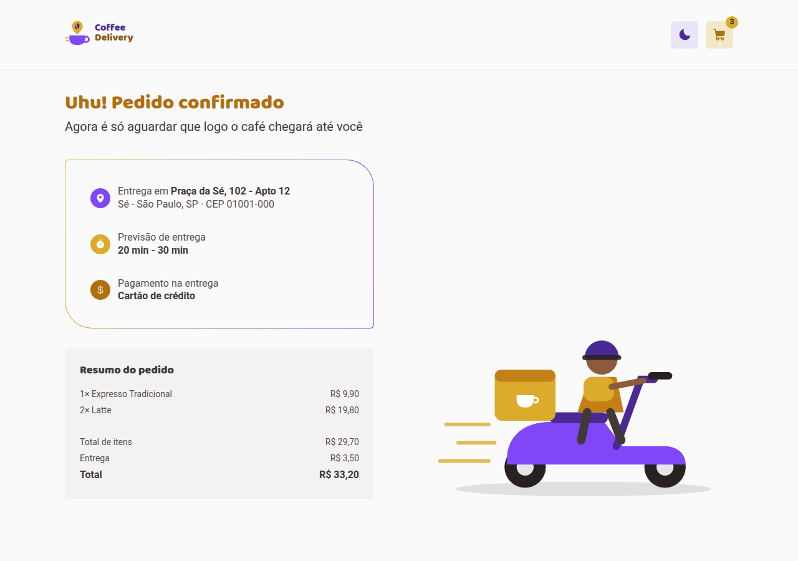 | 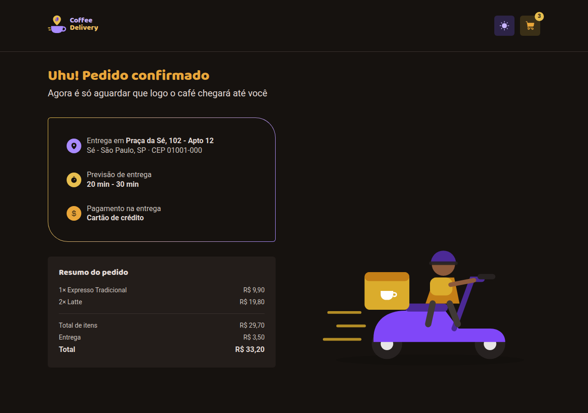 |

### Mobile (390 px)

| Home | Checkout | Sucesso | Home (escuro) | Checkout (escuro) | Sucesso (escuro) |
|---|---|---|---|---|---|
| 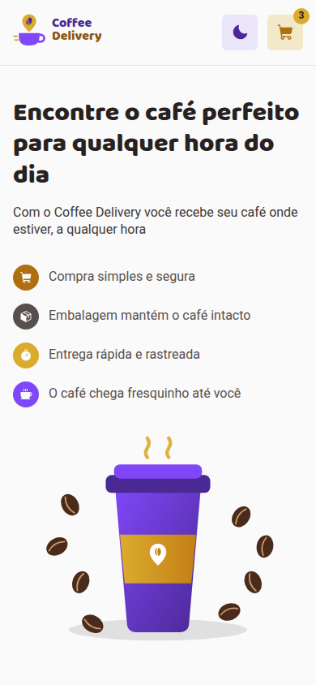 | 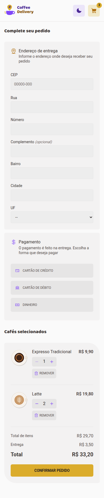 | 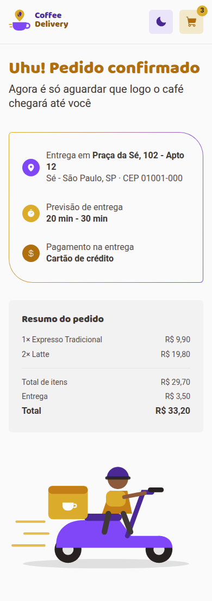 | 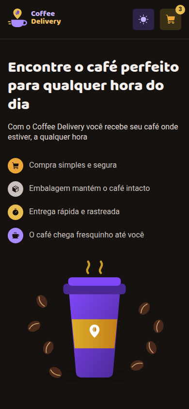 | 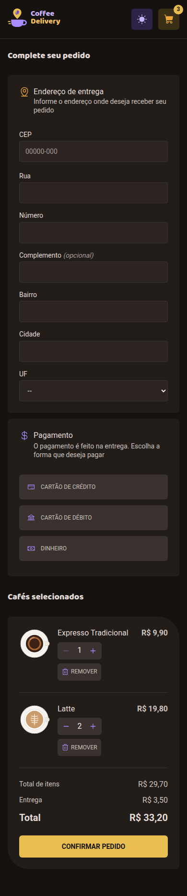 | 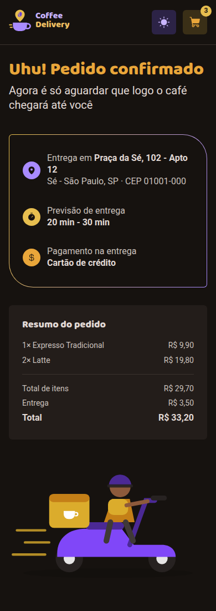 |

## 🎨 Branding com IA

| | |
|---|---|
| 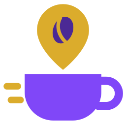 | **Conceito:** "o café vai até você": a fumaça da xícara vira um **pino de localização** com um grão de café dentro; traços de velocidade indicam entrega rápida. |
| **Ferramenta** | Claude Code (Claude Opus 5.5, Anthropic), gerando a logo como **código SVG** vetorial |
| **Prompt** | *"Crie uma logo original em SVG para a cafeteria Coffee Delivery: uma xícara roxa (#8047F8) cuja fumaça forma um pino de localização amarelo (#DBAC2C) com um grão de café dentro, e traços de velocidade à esquerda. Formas geométricas simples, sem texto no ícone, legível em 16–32 px. Gere também a versão com wordmark 'Coffee / Delivery' em Baloo 2 para fundo claro e escuro."* |
| **Por que esta** | Comunica café + entrega numa forma simples; funciona como favicon; SVG inline troca de cor com o tema. |
| **Variações** | [`logo-light.svg`](src/assets/logo-light.svg) · [`logo-dark.svg`](src/assets/logo-dark.svg) · [`logo-icon.svg`](src/assets/logo-icon.svg) · [`favicon.svg`](public/favicon.svg) |
| **Paleta** | Roxo `#8047F8`/`#4B2995`, amarelo `#DBAC2C`/`#B06F0F`, fundo `#FAFAFA` (claro) · roxo `#A98BFF`, amarelo `#E7BE4F`, fundo `#16120F` (escuro) |
| **Tipografia** | Baloo 2 (títulos) + Roboto (textos) |
| **Revisão** | Testada em 16 e 32 px nos dois fundos; contraste do wordmark ajustado após a auditoria axe |
| **Direitos** | Saída gerada pelo usuário com a ferramenta (conferir os termos vigentes da Anthropic); só formas geométricas, sem marcas de terceiros |

As ilustrações dos cafés, do hero e da tela de sucesso também são originais, geradas por
[`scripts/generate-coffee-images.mjs`](scripts/generate-coffee-images.mjs).

## 🤖 Uso de IA no desenvolvimento

O registro completo, com 5 interações (prompt, objetivo, resposta, decisão e evidência), está em
**[`docs/AI_USAGE.md`](docs/AI_USAGE.md)**. Em resumo:

1. **Escopo:** leitura do Notion, levantamento de RF/RN e aviso de que o Figma não pôde ser aberto.
2. **Alinhamento às SPECs:** refatoração para a arquitetura da TECH_SPEC e remoção de funcionalidade fora do PRD.
3. **Branding:** logo SVG com revisão de legibilidade e contraste.
4. **Revisão por testes:** testes e axe encontraram 4 erros no código gerado pela IA, todos corrigidos.
5. **Decisão técnica:** consulta de CEP disparada por evento em vez de efeito.

As diretrizes do assistente estão em [`AGENTS.md`](AGENTS.md). O histórico de commits segue
Conventional Commits, com um commit por tarefa do [`TASKS_SPEC.md`](docs/TASKS_SPEC.md).

## 📌 Pendências

- [ ] Publicar a aplicação e preencher o link no topo deste README (T-27).
- [ ] Rodar o Lighthouse (TC-34) e anexar o resultado.
- [ ] Conferir as telas com o Figma original.
